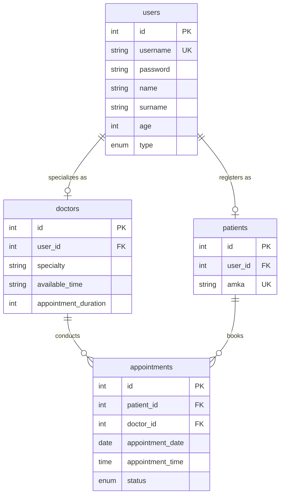

# Hospital Appointment & Patient Management System

[](https://www.oracle.com/java/)
[](https://jakarta.ee/)
[](https://www.mysql.com/)
[](https://maven.apache.org/)
[](https://opensource.org/licenses/MIT)

An enterprise-style healthcare management web application engineered with **Java**, **Jakarta EE (Servlets & JSP)**, and **MySQL**. The system provides end-to-end appointment scheduling, patient records administration, and role-based portals for hospital administrators, physicians, and patients.

---

## 🏛️ System Architecture

The project follows a decoupled **Model-View-Controller (MVC)** architectural pattern:

- **Model (`src/main/java/mainpackage/`)**: Domain entities representing core business logic (`Admin`, `Doctor`, `Patient`, `Appointment`, `Users`).
- **Controller (`src/main/java/com/example/javabasicsweb/`)**: HTTP Servlets handling business actions, session state, and dispatching (`AdminServlet`, `DoctorServlet`, `PatientServlet`, `LoginServlet`).
- **View (`src/main/webapp/`)**: Dynamic JavaServer Pages (JSP) with JSTL providing role-customized user interfaces.
- **Persistence (`src/main/java/.../DBUtil.java`)**: Connection pooling and JDBC abstraction interacting with MySQL with BCrypt hashed credential verification.

### Architecture Diagram
A full UML class diagram modeling inheritance, associations, and cardinalities is available in [`docs/class_diagram.png`](docs/class_diagram.png).

---

## ✨ Core Features

### 🔐 Multi-Tier Role-Based Authentication
- **Secure Sessions**: Role verification on every endpoint to prevent unauthorized escalation.
- **Credential Protection**: BCrypt cryptographic hashing for passwords.
- **User Types**:
  - **Administrator**: Comprehensive hospital oversight, staff enrollment, and schedule audits.
  - **Doctor**: Personalized schedule management, slot availability configuration, and patient consultations.
  - **Patient**: Real-time physician directory, slot reservations, and appointment history tracking.

### 📅 Appointment & Schedule Coordination
- Dynamic doctor availability windows (e.g. morning/evening shifts).
- Conflict-free slot booking with status tracking (`SCHEDULED`, `COMPLETED`, `CANCELLED`).
- Automated validation ensuring appointment slots match active physician working hours.

### 📊 Patient Record & Doctor Registry Management
- AMKA (national health insurance number) validation and patient profiling.
- Physician departmental filtering (Cardiology, Pediatrics, General Medicine, etc.).
- Administrative CRUD operations with cascading relational integrity in MySQL.

---

## 🗄️ Database Schema & Setup

The database schema is partitioned into four relational tables: `users`, `doctors`, `patients`, and `appointments`.



### Quick Database Import
1. Ensure MySQL Server 8.0+ is running.
2. Execute the provided initialization script in the `database/` directory:
   ```bash
   mysql -u root -p < database/schema.sql
   ```
3. Default demo accounts configured:
   - **Administrator**: `admin` / `password123`
   - **Doctor**: `doc_john` / `password123`
   - **Patient**: `patient_mike` / `password123`

---

## 🚀 Getting Started

### Prerequisites
- **JDK 11** or higher
- **Apache Maven 3.8+**
- **Servlet Container**: Apache Tomcat 10+ (supporting Jakarta EE 9 / Servlet 5.0)
- **MySQL Server 8.0+**

### Configuration
Database connection parameters can be provided via environment variables or JVM system properties:

| Variable | Description | Default |
| :--- | :--- | :--- |
| `DB_URL` | JDBC Connection String | `jdbc:mysql://localhost:3306/login_schema` |
| `DB_USER` | MySQL Username | `root` |
| `DB_PASSWORD` | MySQL Password | `""` |

*(See `db.properties.example` for reference).*

### Building the Application
Package the WAR archive using Maven:
```bash
# Using Maven Wrapper
./mvnw clean package

# Or standard Maven
mvn clean package
```
The compiled deployable artifact will be generated at `target/JavaBasicsWeb-1.0-SNAPSHOT.war`.

### Running with Apache Tomcat
Deploy the `.war` to your Tomcat `webapps/` folder, or run directly via an IDE (IntelliJ IDEA / Eclipse) using the Smart Tomcat plugin:
- Context path: `/` or `/JavaBasicsWeb`
- Application URL: `http://localhost:8080/`

---

## 📦 Project Structure

```
hospital-appointment-system/
├── pom.xml                     # Maven build and dependencies (Jakarta EE, JSTL, MySQL)
├── README.md                   # Documentation and usage guide
├── .gitignore                  # Git exclusions for Java/Maven/IDEs
├── db.properties.example       # Database configuration template
├── database/
│   └── schema.sql              # Unified database migration and seed data script
├── docs/
│   └── class_diagram.png       # UML Architecture diagram
├── console-core/               # Foundation OOP domain module (Assignment 1 core)
│   ├── README.md               # Architecture details of the OOP model
│   ├── docs/class_diagram.png  # Console core class diagram
│   └── src/mainpackage/        # Core Java domain entities
└── src/
    └── main/
        ├── java/
        │   ├── com/example/javabasicsweb/   # Servlets & Database utility
        │   └── mainpackage/                 # Web application domain entities
        ├── resources/
        │   └── META-INF/                    # beans.xml, persistence.xml
        └── webapp/                          # JSP Views & WEB-INF/web.xml
```

---

## 🧩 Architectural Evolution: `console-core` Module

This repository incorporates [`console-core/`](console-core/README.md), the original pure Java OOP domain architecture designed in the initial phase of development. It features console-driven workflows, data encapsulation, and patient records file parsing, highlighting the software lifecycle progression from terminal domain design to a full Jakarta EE web enterprise application.

---

## 📄 License
This project is licensed under the MIT License - see the LICENSE file for details.
